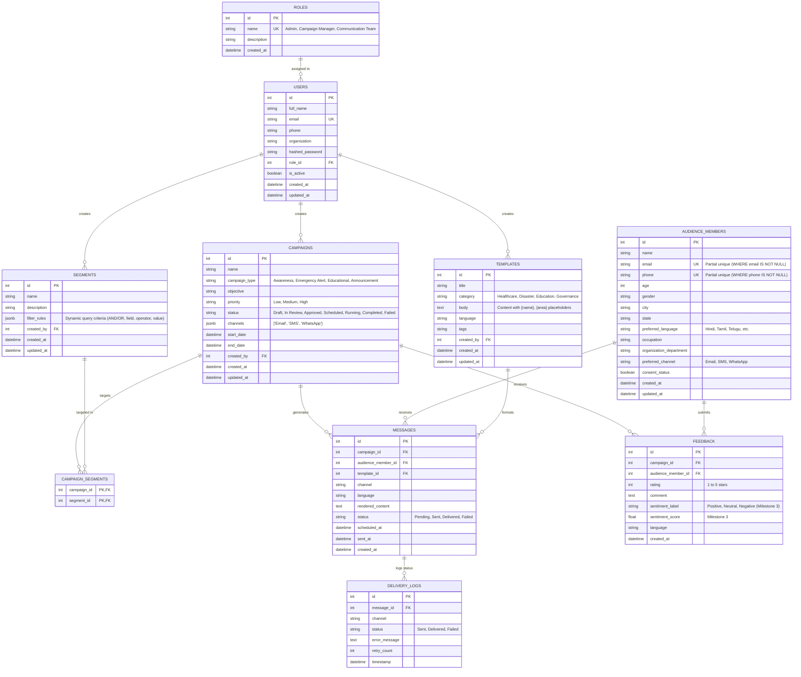

# MassCommAI — Relational Database Architecture (Milestone 1)

This document specifies the initial relational database schema for the **AI-Powered Multilingual Public Awareness and Mass Communication Platform** (Infosys Springboard Virtual Internship).

All tables are versioned and managed through **Alembic** migrations using **PostgreSQL 14+** and **SQLAlchemy 2.x**.

---

## 1. Entity Relationship (ER) Diagram

---

## 2. Table Specifications & Constraints

| Table Name | Primary Purpose | Key Constraints & Indexes |
| :--- | :--- | :--- |
| `roles` | Access-level definitions | `UNIQUE(name)` |
| `users` | Staff, Manager, and Admin credentials | `UNIQUE(email)`, Index on `email`, FK to `roles.id` |
| `audience_members` | Recipient directory for public communication | Partial unique indexes on `email` and `phone` (`WHERE ... IS NOT NULL`), indexes on `preferred_language`, `city`, `preferred_channel` |
| `segments` | Reusable demographic filter definitions | `filter_rules` stored as native PostgreSQL `JSONB`, FK to `users.id` |
| `campaign_segments` | Many-to-Many association | Composite PK `(campaign_id, segment_id)`, Cascading Foreign Keys |
| `campaigns` | Campaign metadata, channels & lifecycle | FK to `users.id`, indexes on `status`, `priority`, `campaign_type` |
| `templates` | Reusable content templates with `{name}` placeholders | FK to `users.id`, indexes on `category`, `language` |
| `messages` | Generated outgoing communication items | FKs to `campaigns`, `audience_members`, and `templates` |
| `delivery_logs` | Channel dispatch audit trail & retries | FK to `messages.id`, index on `status` |
| `feedback` | Recipient satisfaction & future sentiment metrics | FKs to `campaigns` and `audience_members`, rating constraint (1–5) |

---

## 3. Migration Management

- **Tool:** Alembic 1.13+
- **Initial Migration:** `0de49a2cf7ef_initial_schema_all_models.py`
- **Execution Command:** `alembic upgrade head`
- **Rollback Command:** `alembic downgrade -1`
