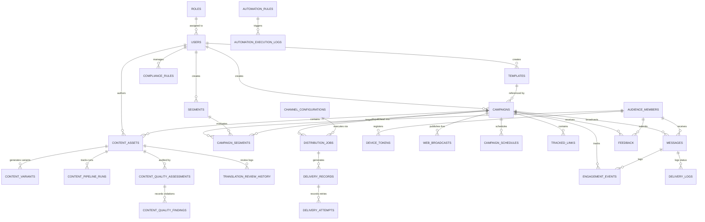

# Civora — Relational Database Architecture
## Complete Data Model Specification (Milestones 1–3 Final Release)
### Powered by MassCommAI — Bringing communities closer.

- **Document Version:** 2.0.0
- **Release Date:** November 19, 2026
- **Architecture Lead:** MassCommAI Core Engineering Team
- **Database Engine:** PostgreSQL 14+ (Cloud-compatible with Neon, AWS RDS, Docker Compose)
- **ORM / Migrations:** SQLAlchemy 2.0.36 / Alembic 1.14.0
- **Current Migration Head:** `b9c3d1e2f4a5` (17 linear revisions)
- **Total Tables:** 30 tables managed via declarative SQLAlchemy models

---

## 1. Complete Entity Relationship (ER) Architecture

The Civora database architecture spans 10 functional domains, providing referential integrity, row-level locking, and indexed audit tracking from citizen demographic ingestion to post-broadcast sentiment analysis.



---

## 2. Table Specifications by Functional Domain

Civora manages exactly 30 relational database tables across 10 functional domains:

### 2.1 Core Identity & Access Governance
| Table Name | Model Class | Primary Purpose | Key Constraints & Indexes |
| :--- | :--- | :--- | :--- |
| `roles` | `Role` | RBAC role definitions (`Admin`, `Campaign Manager`, `Communication Team`). | `UNIQUE(name)`, `PK(id)` |
| `users` | `User` | Institutional administrative users, credentials, role bindings. | `UNIQUE(email)`, Index on `email`, FK to `roles.id` |

### 2.2 Audience Management & Demographic Segmentation
| Table Name | Model Class | Primary Purpose | Key Constraints & Indexes |
| :--- | :--- | :--- | :--- |
| `audience_members` | `AudienceMember` | Citizen demographic registry, language/channel preferences, tri-state consent. | Partial unique indexes on `email` and `phone` (`WHERE ... IS NOT NULL`), indexes on `preferred_language`, `city`, `preferred_channel`, `consent_status` |
| `segments` | `Segment` | Reusable demographic filter definitions compiled to SQL via AST compiler. | FK to `users.id` (`created_by`), `filter_rules` stored as native PostgreSQL `JSONB` |
| `campaign_segments` | Association Table | Many-to-many relationship linking campaigns to target audience segments. | Composite PK `(campaign_id, segment_id)`, Cascading Foreign Keys |

### 2.3 Campaign Governance & Templates
| Table Name | Model Class | Primary Purpose | Key Constraints & Indexes |
| :--- | :--- | :--- | :--- |
| `campaigns` | `Campaign` | Central campaign entity tracking state machine, priority, and scheduled dates. | FK to `users.id`, FK to `templates.id` (`template_id`), indexes on `status`, `priority`, `campaign_type` |
| `templates` | `Template` | Reusable message copy templates with `{name}`, `{city}`, `{date}` placeholders. | FK to `users.id`, indexes on `category`, `language` |

### 2.4 AI Content Studio & Multilingual Engine
| Table Name | Model Class | Primary Purpose | Key Constraints & Indexes |
| :--- | :--- | :--- | :--- |
| `content_assets` | `ContentAsset` | Base drafted content brief, channel constraints, approval state. | FK to `campaigns.id`, FK to `users.id` (`created_by`), indexes on `campaign_id`, `status` |
| `content_variants` | `ContentVariant` | Regional language translations and personalized demographic variants. | FK to `content_assets.id`, Composite Unique Index `(content_asset_id, language, audience_segment)` |
| `content_pipeline_runs`| `ContentPipelineRun` | Tracks unified 5-step AI pipeline execution runs and metrics. | FK to `content_assets.id`, FK to `users.id` (`triggered_by`) |
| `translation_cache` | `TranslationCache` | Keyed translation hash store preventing redundant AI token consumption. | `UNIQUE(cache_key)`, Index on `source_hash`, `target_language` |
| `translation_review_history`| `TranslationReviewHistory`| Audit log for translation review approvals, delegations, and rejections. | FK to `content_assets.id`, FK to `users.id` (`reviewer_id`), Index on `content_asset_id` |

### 2.5 Quality Assurance & Statutory Compliance
| Table Name | Model Class | Primary Purpose | Key Constraints & Indexes |
| :--- | :--- | :--- | :--- |
| `compliance_rules` | `ComplianceRule` | Organization-scoped dynamic rules (banned words, mandatory phrases, regex). | `UNIQUE(rule_code)`, Index on `is_active`, `category`, `organization` |
| `content_quality_assessments`| `ContentQualityAssessment`| Historical automated quality evaluations scoring drafts before approval. | FK to `content_assets.id`, Index on `asset_id`, `created_at` |
| `content_quality_findings`| `ContentQualityFinding` | Specific violations (panic words, missing helplines, readability issues). | FK to `content_quality_assessments.id`, Index on `severity` |

### 2.6 Channel Configuration, Devices & Webcasts
| Table Name | Model Class | Primary Purpose | Key Constraints & Indexes |
| :--- | :--- | :--- | :--- |
| `channel_configurations`| `ChannelConfiguration`| Provider credentials, adapter selection, and sender metadata with API secret masking. | `UNIQUE(channel)`, Index on `channel` |
| `device_tokens` | `DeviceToken` | Citizen FCM push registration tokens with automatic invalidation. | `UNIQUE(token)`, FK to `audience_members.id`, Index on `is_active` |
| `web_broadcasts` | `WebBroadcast` | Public emergency broadcast feed with Server-Sent Events (SSE) support. | FK to `campaigns.id`, Index on `is_active`, `severity` |
| `webhook_events` | `WebhookEvent` | Carrier delivery receipt and status webhook payloads with replay defense. | `UNIQUE(event_id, provider)`, Index on `processed_at` |

### 2.7 Multichannel Distribution Engine
| Table Name | Model Class | Primary Purpose | Key Constraints & Indexes |
| :--- | :--- | :--- | :--- |
| `distribution_jobs` | `DistributionJob` | Asynchronous broadcast dispatch jobs, worker lease fencing, overall counters. | FK to `campaigns.id`, Index on `status`, `lease_expires_at` |
| `delivery_records` | `DeliveryRecord` | Individual citizen message delivery records with non-nullable masked PII. | FK to `distribution_jobs.id`, FK to `audience_members.id`, `masked_recipient_address` |
| `delivery_attempts` | `DeliveryAttempt` | Step-by-step cross-channel fallback logs (`WhatsApp` $\to$ `SMS` $\to$ `Email`). | FK to `delivery_records.id`, Index on `channel`, `status` |

### 2.8 Scheduling & Event-Driven Automation
| Table Name | Model Class | Primary Purpose | Key Constraints & Indexes |
| :--- | :--- | :--- | :--- |
| `campaign_schedules` | `CampaignSchedule` | APScheduler cron and one-shot execution timestamps for scheduled campaigns. | FK to `campaigns.id`, Index on `scheduled_time`, `is_executed` |
| `automation_rules` | `AutomationRule` | Event-driven trigger rules linking environmental metrics to automated dispatches. | Index on `is_active`, `event_type` |
| `automation_execution_logs`| `AutomationExecutionLog`| Execution logs and outcome status for triggered automation rules. | FK to `automation_rules.id`, Index on `executed_at` |

### 2.9 Citizen Engagement Tracking & Sentiment Feedback
| Table Name | Model Class | Primary Purpose | Key Constraints & Indexes |
| :--- | :--- | :--- | :--- |
| `tracked_links` | `TrackedLink` | Shortened URL identifiers embedded in messages to track Click-Through Rates. | `UNIQUE(link_id)`, Index on `link_id`, FK to `campaigns.id`, FK to `messages.id` |
| `engagement_events` | `EngagementEvent` | Detailed timestamped event logs for email opens (pixel) and link clicks. | FK to `campaigns.id`, FK to `messages.id`, FK to `audience_members.id`, Index on `event_type`, `timestamp` |
| `feedback` | `Feedback` | Citizen survey responses, 1–5 star ratings, and hybrid sentiment analysis scores. | FK to `campaigns.id`, FK to `audience_members.id`, Index on `created_at`, `sentiment_label` |

### 2.10 Communication Audit Logs & Retries
| Table Name | Model Class | Primary Purpose | Key Constraints & Indexes |
| :--- | :--- | :--- | :--- |
| `messages` | `Message` | Granular dispatched communication log tracking rendered content and delivery status. | FK to `campaigns.id`, FK to `audience_members.id`, FK to `templates.id`, Index on `created_at` |
| `delivery_logs` | `DeliveryLog` | Chronological dispatch logs with gateway error messages and retry counters. | FK to `messages.id`, Index on `status`, `timestamp` |

---

## 3. Verified Linear Alembic Migration History

The schema is maintained through a strictly linear, forward-only chain of 17 Alembic migrations with zero branches:

```text
0de49a2cf7ef (initial_schema_all_models)
     ↓
1a2b3c4d5e6f (allow_nullable_consent_status)
     ↓
a2da4799cf83 (add_template_id_to_campaigns)
     ↓
b3ea5891de12 (create_content_assets_table)
     ↓
c4fb6902ef23 (add_content_quality_evaluations)
     ↓
d5ec7a12fb34 (add_multichannel_distribution_engine)
     ↓
c069b45597ab (add_worker_lease_and_retry_backoff)
     ↓
f4b8c12a7d3e (add_translation_cache_and_pipeline)
     ↓
a1d8f349b2c1 (add_translation_variant_unique_index)
     ↓
e6c7d81a9f02 (add_compliance_rules_table)
     ↓
b7d4e1f8a29c (add_content_variants_table)
     ↓
a4c8e1f5d2b7 (add_content_pipeline_runs_table)
     ↓
c5e8b2d1f4a9 (add_channel_configs_and_extend_messages)
     ↓
d6f9c3e2b5a1 (add_task14_multichannel_and_webhooks)
     ↓
e7a1b4c3d2e5 (add_task15_scheduling_automation_retry)
     ↓
f8b2c5d4e3a6 (add_task16_engagement_tracking_sentiment)
     ↓
b9c3d1e2f4a5 (HEAD - add_message_and_feedback_created_at_indexes)
```

---

## 4. Database Migration & Maintenance Commands

### Apply Latest Migrations
From the repository root:
```bash
alembic -c backend/alembic.ini upgrade head
```

### Inspect Migration Status
```bash
alembic -c backend/alembic.ini current
alembic -c backend/alembic.ini heads
```

### Idempotent Demonstration Data Seeding
The project provides an idempotent demo seeding utility that populates clean reference records across all 30 tables without creating duplicate entries:
```bash
python -m app.db.seed_demo
```
