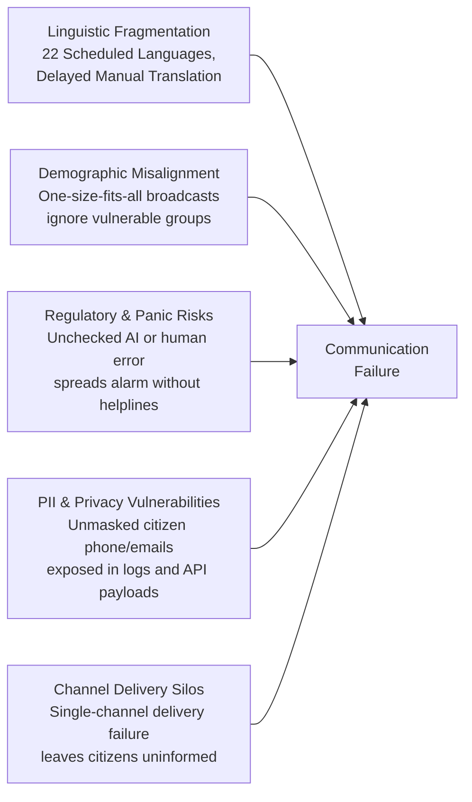
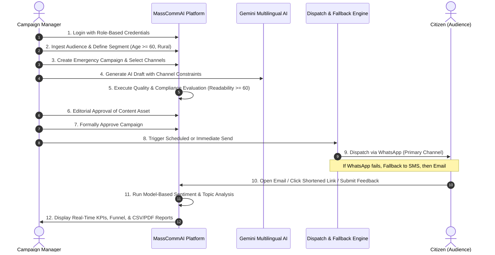
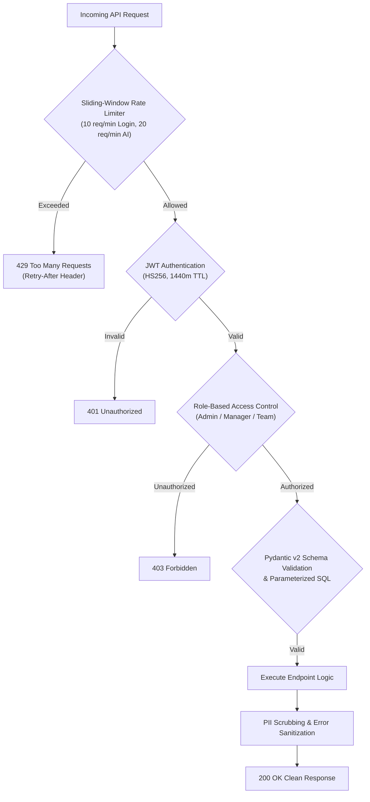

# MassCommAI — Final Project Presentation Material
## AI-Powered Multilingual Public Awareness, Audience Segmentation, and Mass Communication Platform

**Internship Program:** Infosys Springboard Virtual Internship
**Project Track:** AI & Cloud Solutions for Civic Governance
**Author / Engineering Lead:** MassCommAI Core Engineering Team
**Date:** November 2026
**Final Release:** Milestone 3 Final Release (v1.0.0-prod)

---

## Slide 1: Title & Executive Summary

### Title
**MassCommAI: Enterprise-Grade AI-Powered Multilingual Public Awareness and Mass Communication Platform**

### Subtitle
*Bridging Linguistic and Demographic Communication Chasms Across India's 1.4 Billion Citizens with Privacy-First Automation, Intelligent Fallback, and Civic Sentiment Analysis.*

### Executive Summary
MassCommAI is a production-hardened, full-stack civic communication engine designed specifically for disaster management authorities, public health directorates, civic municipalities, and government departments. The platform unifies:
1. **Zero-PII-Leak Demographic Audience Segmentation** with dynamic AST query compilation.
2. **Channel-Constrained Multilingual Content Synthesis** (English, Hindi, Tamil, Telugu, Bengali, Marathi, etc.) with strict placeholder protection and automated editorial safety gates.
3. **Multi-Channel Simulated & Carrier-Ready Distribution Engine** covering Email (SMTP/SES), SMS (Twilio/CDAC), WhatsApp (Meta Cloud API), Push Notifications (Web/FCM), and Emergency Web Broadcasts.
4. **Resilient Delivery Orchestration** featuring automated multi-channel fallbacks, exponential backoff retries, and bidirectional carrier webhooks.
5. **Civic Engagement & Sentiment Intelligence** tracking delivery logs, email opens, URL click-throughs, citizen feedback, and model-based/lexicon sentiment analytics.
6. **Executive Analytics Dashboards** delivering cross-campaign performance metrics, channel conversion funnels, language engagement rankings, and automated AI improvement insights.

---

## Slide 2: The Civic Communication Dilemma (Problem Statement)

Massive public awareness drives and emergency alert dispatches in India face five critical operational bottlenecks:



1. **Linguistic Fragmentation:** India encompasses 22 scheduled languages with hundreds of regional dialects. Manual translation of urgent advisories causes fatal delays and semantic distortion.
2. **Demographic Misalignment:** One-size-fits-all broadcasts fail to engage vulnerable populations (e.g., senior citizens needing simple healthcare advice vs. rural farmers needing crop weather alerts).
3. **Panic & Regulatory Risks:** Poorly worded public health or disaster advisories can induce mass panic or omit mandatory statutory emergency helplines.
4. **Accidental PII Exposure:** Standard mass-mailing/broadcasting tools expose citizen phone numbers, email addresses, and identities in logs, browser payloads, and delivery queues.
5. **Channel Delivery Silos:** When an SMS gateway fails or a citizen lacks internet data for WhatsApp, standard broadcasts fail without automatic cross-channel fallback.

---

## Slide 3: Project Vision & Strategic Objectives

### Vision
*To empower public administrators with an intelligent, reliable, auditable, and privacy-preserving platform capable of synthesizing, auditing, and dispatching localized public advisories to millions in seconds.*

### Strategic Objectives
- **Targeted Precision:** Filter audiences dynamically via visual rule builders supporting nested AND/OR criteria without raw SQL exposure.
- **Multilingual Speed:** Reduce advisory authoring and translation latency from days to under 60 seconds using Google Gemini AI with strict placeholder retention (`{name}`, `{location}`, `{date}`).
- **Editorial Safety Gate:** Enforce mandatory automated compliance checks (Flesch-Kincaid readability, sentiment guardrails, emergency helpline verification) before any campaign can be approved.
- **Resilient Delivery:** Guarantee message arrival via multi-channel fallback (`WhatsApp` $\to$ `SMS` $\to$ `Email`) with maximum 3 retry attempts and exponential backoff.
- **Citizen Feedback Loop:** Empower citizens to submit feedback in their native language and analyze community sentiment to guide governance decisions.
- **Enterprise Security:** Enforce strict RBAC boundaries, sliding-window rate limiting, PII redaction in application logs, and robust SQL injection safeguards.

---

## Slide 4: End-to-End System Architecture

```mermaid
flowchart TD
    subgraph ClientLayer["Frontend Client (React 18 + Vite 6)"]
        UI_Nav["Role-Based Navigation\n(Admin / Manager / Team)"]
        UI_Studio["Content Pipeline Wizard &\nMultilingual Studio"]
        UI_Dash["Executive Analytics &\nFeedback Monitoring"]
        UI_Lang["Bilingual UI Switcher\n(English / Hindi)"]
    end

    subgraph SecurityLayer["Security & Gateway Perimeter"]
        CORS["Strict Production CORS"]
        RateLimiter["Sliding-Window Rate Limiter\n(Redis / In-Memory Deque)"]
        JWTMiddleware["JWT Auth & Hierarchical RBAC"]
        PIIFilter["Log PII Redacting Filter\n(Scrubs emails, phones, tokens)"]
        ErrHandler["Global 500 Sanitizer"]
    end

    subgraph CoreBackend["FastAPI Backend Application (Port 8000)"]
        Router_Auth["/auth & /admin/users"]
        Router_Aud["/audience & /segments"]
        Router_Camp["/campaigns & /templates"]
        Router_Content["/content & /content/quality"]
        Router_Dist["/distribution & /campaigns/{id}/send"]
        Router_Webhooks["/webhooks & /feedback"]
        Router_Analytics["/analytics"]
    end

    subgraph Services["Domain Intelligence Engine"]
        ASTCompiler["AST Query Compiler (SQLAlchemy 2.0)"]
        AIFactory["AI Provider Factory (Gemini 2.5 / Mock)"]
        QualityRules["Compliance & Readability Heuristics"]
        ChannelRegistry["Channel Registry & Dispatch Engine"]
        RetryManager["Retry Manager & Fallback Evaluator"]
        SentimentSvc["Hybrid Sentiment (Model + Lexicon)"]
    end

    subgraph StorageLayer["Data & Cache Layer"]
        PG[("PostgreSQL 16\n(17 Tables, B-Tree Indexes)")]
        RedisCache[("Redis 7\n(Rate Limiting & Celery Queues)")]
    end

    subgraph Channels["External Providers (Simulated / Live)"]
        EmailCh["Email (SMTP / Amazon SES)"]
        SMSCh["SMS (Twilio / CDAC Gateway)"]
        WACh["WhatsApp (Meta Cloud API)"]
        PushCh["Web Push (FCM / VAPID)"]
        BroadcastCh["Web Broadcast (Public Feed)"]
    end

    ClientLayer --> SecurityLayer
    SecurityLayer --> CoreBackend
    CoreBackend --> Services
    Services --> StorageLayer
    Services --> Channels
```



---

## Slide 5: Technology Stack & Technical Highlights

| Component | Technology | Version | Key Engineering Justification |
| :--- | :--- | :--- | :--- |
| **Backend Framework** | **FastAPI** | `0.115.6` | High-throughput asynchronous ASGI, native Pydantic v2 validation, auto-generated OpenAPI 3.1 docs. |
| **Database & ORM** | **PostgreSQL + SQLAlchemy** | `16.15` / `2.0.36` | ACID compliance, row-level lease fencing (`SELECT ... FOR UPDATE`), composite indexes on message timestamps. |
| **Database Migrations** | **Alembic** | `1.14.0` | Linear forward/rollback database versioning (8 verified revisions up to `b9c3d1e2f4a5`). |
| **Caching & Rate Limiting**| **Redis + Py-Redis** | `7.2` / `5.2.1` | Sliding-window sorted sets (`ZREMRANGEBYSCORE`, `ZCARD`, `ZADD`) with in-memory thread-safe fallback. |
| **Background Scheduling**| **APScheduler / BackgroundTasks**| `3.10.4` | In-process crontab and delayed one-shot job scheduling with persistent state tracking. |
| **Frontend Framework** | **React + Vite** | `18.3.1` / `6.0.3` | Ultra-fast HMR, route-level code splitting via `React.lazy`, manual vendor chunking (<165 kB per chunk). |
| **UI Design System** | **Tailwind CSS + Lucide** | `3.4.16` / `0.468` | Clean civic dashboard aesthetic, fully responsive mobile layouts, bilingual UI toggles. |
| **AI Synthesis Engine** | **Google Gemini 2.5 Flash** | `@google/genai` | High-speed multilingual inference with deterministic offline mock provider fallback for air-gapped CI/CD. |
| **Containerization** | **Docker & Docker Compose** | Multi-Stage | Non-root `appuser` (UID 10001), NGINX alpine reverse proxy, persistent volume mounts. |

---

## Slide 6: Core Workflow Demonstration (The 12-Step Lifecycle)

Every communication campaign follows an auditable 12-stage lifecycle from citizen demographic ingestion to post-broadcast civic impact analysis:



---

## Slide 7: Breakthrough Innovations

### 1. Dynamic AST Demographic Query Compiler
- Compiles nested visual logic (`AND`, `OR`, `NOT`) directly into parameterized SQLAlchemy binary expressions.
- Zero risk of SQL injection: rejects arbitrary strings and executes exclusively against strongly-typed database columns (`age`, `location`, `gender`, `occupation`, `preferred_language`, `consent_status`).

### 2. Multi-Channel Fallback & Exponential Retry Engine
- Supports configurable cascade paths (e.g., `WhatsApp` $\to$ `SMS` $\to$ `Email`).
- When a provider reports `failed` or encounters network timeouts, the retry worker automatically logs the failure, increments the attempt count (max 3), and re-dispatches to the next fallback channel.

### 3. Automated Editorial Safety & Compliance Gate
- Hard-blocks publication of any draft that scores below readability thresholds or triggers the **Panic Word Detection Filter** (e.g., *"lethal"*, *"deadly catastrophe"*).
- Enforces statutory government requirements: emergency advisories must contain official helpline numbers (e.g., `108`, `112`, `1077`).

### 4. Privacy-by-Design & Zero-PII Boundary
- Strict log filtering scrubs email addresses, 10-digit phone numbers, JWT bearer tokens, and webhook secrets from stdout and disk logs.
- API responses enforce non-nullable masked recipient addresses (`+919****3210`, `j****@example.com`).

### 5. Hybrid Sentiment Intelligence
- Incoming SMS/WhatsApp replies and public web feedback are analyzed through an LLM provider (Gemini) with deterministic lexicon fallback.
- Classifies responses into `Positive`, `Neutral`, or `Negative` with normalized confidence scores and automated civic topic extraction.

---

## Slide 8: Enterprise Security Hardening

MassCommAI implements multi-layered security controls to protect civic infrastructure from unauthorized access, automated abuse, and data leakage:



- **Sliding-Window Rate Limiter:** Protects `/auth/login` (10 req/min) and `/content/generate`, `/content/{id}/personalize` (20 req/min) using Redis sorted sets with in-memory thread-safe fallback.
- **Production CORS Validation:** Hard-blocks wildcard `*` origins in staging and production environments.
- **Log PII Masking Filter:** Automatic regex scrubbing of citizen phone numbers, emails, passwords, and bearer tokens across Python standard logging.
- **Global 500 Sanitizer:** Catches unhandled exceptions and returns structured `INTERNAL_SERVER_ERROR` JSON payloads without exposing Python stack traces or database connection strings.

---

## Slide 9: Verification Metrics & Test Suite Evidence

MassCommAI has been subjected to rigorous automated verification across all layers of the application:

| Verification Metric | Target Benchmark | Actual Verified Result | Status |
| :--- | :---: | :---: | :---: |
| **Backend Test Suite** | $> 500$ passing tests | **522 Passed** (0 failures, 0 skipped) | **PASS** |
| **Test Execution Time** | $< 180$ seconds | **140.23 seconds** | **PASS** |
| **Security Hardening Tests**| 100% pass | **6 / 6 Passed** | **PASS** |
| **End-to-End Workflow Tests**| 12-stage pass | **1 / 1 Complete Pipeline Passed** | **PASS** |
| **Database Migrations** | Single clean head | **1 Head (`b9c3d1e2f4a5`)** | **PASS** |
| **Frontend Production Build**| No bundle warnings | **Vite build in 1.23s (<165 kB chunks)**| **PASS** |
| **Demo Seeding Idempotency**| Zero duplicates | **100% Idempotent (0 duplicate records)**| **PASS** |
| **Log PII Redaction** | Zero raw credentials | **100% Redacted (`[PHONE_MASKED]`, etc.)**| **PASS** |

---

## Slide 10: Live Demonstration Overview

The platform is demo-ready with pre-seeded civic scenarios accessible via role-based credentials:

### Demo Credentials
- **Administrator:** `admin@masscomm.gov.in` / `Admin@12345` (Full access, user governance, compliance rules)
- **Campaign Manager:** `manager@masscomm.gov.in` / `Manager@12345` (Segmentation, AI studio, approvals, dispatch, analytics)
- **Communication Team:** `team@masscomm.gov.in` / `Team@12345` (Content drafting, translation, view-only analytics)

### 7 Demonstration Acts
1. **Act I:** Multi-Role Login & Security Boundary Check.
2. **Act II:** Demographic Audience Filtering & Segment Compilation.
3. **Act III:** Multilingual AI Generation with Quality Audit & Approval Gate.
4. **Act IV:** Multi-Channel Broadcast with Simulated Provider Execution.
5. **Act V:** Delivery Tracking, Link Redirection & Citizen Native Feedback.
6. **Act VI:** Executive Analytics Dashboard & Report Export (CSV/PDF).
7. **Act VII:** Security Hardening Verification (Rate Limiting & Log PII Redaction).

*(Refer to `docs/DEMO_WALKTHROUGH_SCRIPT.md` for the line-by-line presenter script).*

---

## Slide 11: Production Deployment & Containerization

MassCommAI provides a turnkey production container setup via Docker and Docker Compose:

```text
├── docker-compose.yml       # 4-tier orchestration (db, redis, backend, frontend)
├── backend/
│   └── Dockerfile           # Multi-stage python:3.13-slim, non-root appuser (UID 10001)
└── frontend/
    ├── Dockerfile           # Multi-stage Node 20 builder -> NGINX 1.25 alpine runner
    └── nginx.conf           # Gzip compression, security headers, SPA rewrite fallback
```

### 1-Command Startup
```bash
docker compose up --build -d
```
- **Frontend SPA:** `http://localhost:3000` (NGINX reverse proxy with `/healthz` probe)
- **Backend API:** `http://localhost:8000` (FastAPI with Uvicorn workers and `/health` probe)
- **PostgreSQL Database:** `localhost:5432` (Healthchecked via `pg_isready`)
- **Redis Cache & Queue:** `localhost:6379` (Healthchecked via `redis-cli ping`)

---

## Slide 12: Roadmap Progression & Future Horizons

### Roadmap Milestones Completed
- [x] **Milestone 1 (Tasks 1–6):** Audience Ingestion, Dynamic Segmentation, Campaign State Machine, Template Library.
- [x] **Milestone 2 (Tasks 7–12):** Multilingual AI Content Studio, Translation Engine (10 Indian languages), Tone Optimization, Automated Quality Audit, End-to-End Pipeline Wizard.
- [x] **Milestone 3 (Tasks 13–18):** Multichannel Delivery (Email, SMS, WhatsApp, Push, Broadcast), Scheduling & Retries, Feedback Sentiment Analysis, Executive Analytics Dashboards, Security Hardening & Containerization.

### Future Horizons
1. **GovTech Telecom API Integration:** Direct integration with CDAC Jan Parichay, NIC SMS gateway, and official Meta WhatsApp Cloud API accounts.
2. **Local Speech Synthesis:** Integration with Bhashini IndicTTS to deliver automated audio phone advisories to illiterate populations.
3. **Bidirectional WhatsApp Conversational AI:** Expanding inbound webhook handling to support conversational citizen queries regarding relief center locations.
4. **Offline Mobile Mesh Dispatches:** Bluetooth low-energy and Wi-Fi Direct peer-to-peer relay for post-disaster communication when telecom towers fail.

---

## Slide 13: Conclusion & Q&A

### Summary of Achievements
- Delivered an end-to-end, enterprise-grade civic communication platform for India's diverse multilingual population.
- Achieved a resilient architecture backed by **522 automated tests**, strict PII protection, and modular containerization.
- Established an auditable bridge between generative AI and public administration safety standards.

### Thank You!
**Open for Questions, Demonstration, and Architecture Discussion.**
