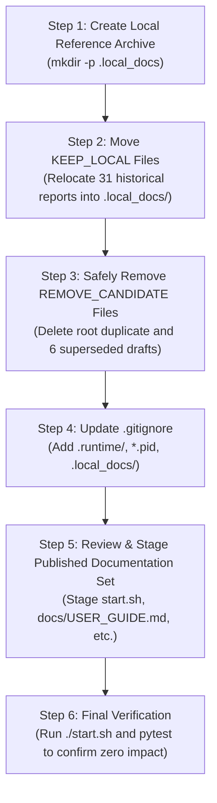

# MassCommAI — Repository Documentation & Architecture Audit Report
## Phase 1: Comprehensive Read-Only Audit & Classification Matrix

**Date of Audit:** November 18, 2026  
**Auditor:** DeepMind Antigravity Technical Architecture & Quality Assurance Lead  
**Target Repository:** `/Users/hariprasathc/Projects/MassCommAI`  
**Git Branch:** `main` (Ahead of `origin/main` by 9 commits)  
**Git HEAD Commit:** `324aaa172a512b16afd594a5cced787494829374` (`324aaa1`)  
**Audit Classification:** Strictly Read-Only Repository & Documentation Inventory  
**Deliverable Document:** `docs/MASSCOMMAI_REPOSITORY_DOCUMENTATION_AUDIT.md`  

---

## Executive Summary

A comprehensive, evidence-based, read-only audit of all documentation, runtime assets, scripts, configuration files, and git tracking states was conducted across the MassCommAI repository.

The repository currently contains:
- **48 Markdown documentation files** totaling **900,974 bytes** across the root directory (2 files), `docs/` (40 files), and `reports/` (6 files).
- **1 Shell startup orchestrator** (`start.sh`) totaling 27,473 bytes at root.
- **1 Runtime state directory** (`.runtime/`) containing 3 active PID tracking files.
- **1 Application log directory** (`logs/`) containing backend and frontend logs.
- **3 Secret/Environment templates** (`.env.example`, `backend/.env.example`, `frontend/.env.example`).
- **Complete Full-Stack Application Codebase:** FastAPI backend (Python 3.13), React/Vite frontend (Node v26 / React 18), 17 Alembic database migrations (`b9c3d1e2f4a5 (head)`), and Docker container configurations.

### Key Audit Findings:
1. **GitHub Presentation Readiness:** While the application codebase is 100% complete and verified (525/525 pytest tests passing, Vite production build clean, full-stack workflow verified), the documentation tree is currently overburdened with **intermediate task-level reports, duplicate audit checkpoints, and fragmented remediation logs**.
2. **Untracked Documentation Overhang:** Out of 40 markdown documents in `docs/`, only **5 files are currently tracked in Git** (`DATABASE_DESIGN.md`, `DEMO_WALKTHROUGH_SCRIPT.md`, `FINAL_PRESENTATION_MATERIAL.md`, `M3_TASK18_SYSTEM_FINALIZATION_COMPLETION_REPORT.md`, `USER_GUIDE.md`). The remaining 35 files in `docs/` and all 6 files in `reports/` are completely untracked.
3. **Exact Redundant Duplication:** `FINAL_ENGINEERING_CLEANUP_REPORT.md` exists simultaneously in the root directory (15,432 bytes) and inside `docs/` (15,431 bytes). They are byte-for-byte identical duplicates (differing by exactly one trailing newline).
4. **Superseded Audit Layers:** Several early checkpoint reports (such as `M3_FINAL_ACCEPTANCE_VERIFICATION_REPORT.md`, `M2_TASK7_STEP2_...`, `M2_TASK7_STEP3_...`, `M2_TASK8_INDEPENDENT_...`, and `task9_checkpoint4_...`) were preliminary milestones whose findings have been fully integrated and resolved in later consolidated sign-offs and master audits.
5. **Git Ignore Gap:** The newly created `.runtime/` directory (storing `start.pid`, `backend.pid`, `frontend.pid` from `./start.sh`) is currently untracked and is **not listed in `.gitignore`**, creating an accidental commit hazard.
6. **Valuable Technical Assets to Preserve:** Documents such as `MILESTONE_2_ARCHITECTURE.md`, `MILESTONE_2_MASTER_AUDIT.md`, `PROJECT_TECHNICAL_AUDIT.md`, and individual Milestone 3 task completion reports contain extraordinary technical and architectural depth (mathematical formulas, AST compiler specs, forensic lease race condition analyses) that should **not be discarded**, but rather archived in a dedicated local reference repository (`.local_docs/`) so the public GitHub repository remains clean, authoritative, and uncluttered.

---

## 1. Complete Repository Inventory

### 1.1 Root Directory Inventory
| Path | Type | Git State | Size | Description / Purpose |
| :--- | :---: | :---: | :---: | :--- |
| `README.md` | File (Markdown) | Tracked (Modified) | 26,070 B | Primary GitHub repository landing page; architecture, tech stack, quickstart, API overview. |
| `FINAL_ENGINEERING_CLEANUP_REPORT.md` | File (Markdown) | Untracked | 15,432 B | Duplicate copy of `docs/FINAL_ENGINEERING_CLEANUP_REPORT.md` sitting in root. |
| `start.sh` | File (Shell Script) | Untracked | 27,473 B | Unified end-to-end application startup orchestrator (Postgres, Redis, Backend, Frontend). |
| `.env.example` | File (Config) | Tracked | 669 B | Root environment variable template. |
| `docker-compose.yml` | File (YAML) | Tracked | 2,456 B | Multi-container Docker composition (db, redis, backend, frontend). |
| `.gitignore` | File (Config) | Tracked | 731 B | Git exclusion patterns. |
| `.runtime/` | Directory | Untracked | 160 B | Ephemeral PID files (`start.pid`, `backend.pid`, `frontend.pid`) generated by `./start.sh`. |
| `logs/` | Directory | Ignored (`.gitignore`)| 128 B | Application runtime log output (`backend.log`, `frontend.log`). |
| `.pytest_cache/` | Directory | Ignored (`.gitignore`)| 192 B | Pytest runtime cache. |
| `backend/` | Directory | Tracked | 384 B | FastAPI application, database models, services, migrations, and test suites. |
| `frontend/` | Directory | Tracked | 480 B | React 18, Vite 6, Tailwind CSS frontend application source code. |
| `docs/` | Directory | Mixed (5 tracked, 35 untracked) | 1,344 B | Documentation, architectural blueprints, audits, and completion reports. |
| `reports/` | Directory | Untracked (6 files) | 256 B | Historical Milestone 1 and early Task 9 audit reports. |

---

### 1.2 Documentation Inventory Summary
```
MassCommAI/
├── README.md                                          [Tracked, Modified]
├── FINAL_ENGINEERING_CLEANUP_REPORT.md                 [Untracked - Duplicate of docs/]
├── start.sh                                           [Untracked]
├── docs/                                              [40 files]
│   ├── DATABASE_DESIGN.md                             [Tracked]
│   ├── DEMO_WALKTHROUGH_SCRIPT.md                     [Tracked]
│   ├── FEATURE_INVENTORY.md                           [Untracked]
│   ├── FINAL_ENGINEERING_CLEANUP_REPORT.md            [Untracked]
│   ├── FINAL_PRESENTATION_MATERIAL.md                 [Tracked]
│   ├── M2_PHASE1A_APPROVAL_SECURITY_COMPLETION_REPORT.md [Untracked]
│   ├── M2_PHASE1B_DYNAMIC_COMPLIANCE_COMPLETION_REPORT.md [Untracked]
│   ├── M2_PHASE2_COMPLETION_REPORT.md                 [Untracked]
│   ├── M2_PHASE2_READINESS_AUDIT.md                   [Untracked]
│   ├── M2_TASK12_FINAL_ACCEPTANCE_REPORT.md           [Untracked]
│   ├── M2_TASK12_PIPELINE_COMPLETION_REPORT.md        [Untracked]
│   ├── M2_TASK7_STEP2_CAMPAIGN_PROMPT_INGESTION_REPORT.md [Untracked]
│   ├── M2_TASK7_STEP3_CHANNEL_CONSTRAINTS_AUDIT.md    [Untracked]
│   ├── M2_TASK7_STEP3_CHANNEL_CONSTRAINTS_IMPLEMENTATION.md [Untracked]
│   ├── M2_TASK7_STEP4_FRONTEND_CHANNEL_CONSTRAINTS_AUDIT.md [Untracked]
│   ├── M2_TASK7_STEP4_FRONTEND_CHANNEL_CONSTRAINTS_IMPLEMENTATION.md [Untracked]
│   ├── M2_TASK8_FINAL_SIGNOFF_REPORT.md               [Untracked]
│   ├── M2_TASK8_IMPLEMENTATION_REPORT.md              [Untracked]
│   ├── M2_TASK8_INDEPENDENT_AUDIT_REPORT.md           [Untracked]
│   ├── M2_TASK8_REMEDIATION_REPORT.md                 [Untracked]
│   ├── M2_TASK9_ARCHITECTURE_AUDIT.md                 [Untracked]
│   ├── M2_TASK9_PHASE1_COMPLETION_REPORT.md           [Untracked]
│   ├── M2_TASK9_PHASE2_ARCHITECTURE_AUDIT.md          [Untracked]
│   ├── M2_TASK9_PHASE2_COMPLETION_REPORT.md           [Untracked]
│   ├── M3_FINAL_ACCEPTANCE_VERIFICATION_REPORT.md     [Untracked]
│   ├── M3_TASK13_CHANNEL_INTEGRATION_COMPLETION_REPORT.md [Untracked]
│   ├── M3_TASK14_MULTICHANNEL_COMPLETION_REPORT.md    [Untracked]
│   ├── M3_TASK15_SCHEDULING_AUTOMATION_COMPLETION_REPORT.md [Untracked]
│   ├── M3_TASK16_ENGAGEMENT_SENTIMENT_COMPLETION_REPORT.md [Untracked]
│   ├── M3_TASK17_ANALYTICS_DASHBOARDS_COMPLETION_REPORT.md [Untracked]
│   ├── M3_TASK18_SYSTEM_FINALIZATION_COMPLETION_REPORT.md [Tracked]
│   ├── MASSCOMMAI_FINAL_END_TO_END_ACCEPTANCE_REPORT.md [Untracked]
│   ├── MASSCOMMAI_FINAL_INDEPENDENT_VERIFICATION_REPORT.md [Untracked]
│   ├── MILESTONE_2_ARCHITECTURE.md                    [Untracked]
│   ├── MILESTONE_2_MASTER_AUDIT.md                    [Untracked]
│   ├── MILESTONE_2_ROADMAP.md                         [Untracked]
│   ├── PROJECT_TECHNICAL_AUDIT.md                     [Untracked]
│   ├── UI_UX_REDESIGN_REPORT.md                       [Untracked]
│   ├── USER_GUIDE.md                                  [Tracked]
│   └── VISUAL_FUNCTIONAL_ACCEPTANCE_AUDIT.md          [Untracked]
└── reports/                                           [6 files, all Untracked]
    ├── milestone_1_final_acceptance_audit.md          [Untracked]
    ├── milestone_1_task6_remediation_report.md        [Untracked]
    ├── task9_checkpoint4_acceptance_report.md         [Untracked]
    ├── task9_final_acceptance_report.md               [Untracked]
    ├── task9_final_signoff.md                         [Untracked]
    └── task9_signoff_verification.md                  [Untracked]
```

---

## 2. Documentation File-by-File Analysis

Every single documentation file across the repository was inspected in detail. Below is the comprehensive forensic analysis:

### 2.1 Public User & System Documentation (Core Set)

#### 1. `README.md`
- **Location:** `/Users/hariprasathc/Projects/MassCommAI/README.md`
- **Size / Lines:** 26,070 B / 489 lines
- **Git Status:** Tracked (Modified)
- **Main Purpose & Contents:** Authoritative GitHub landing page for the entire project. Covers professional project overview, problem statement, key differentiators, technology stack, unified quickstart (`./start.sh`), step-by-step installation, Docker commands, demo seeding instructions, complete API endpoint inventory, and automated test execution.
- **Unique Information:** Yes. Contains the public-facing quickstart instructions, shield badges, port configurations, and repository architecture tree.
- **Overlaps:** Synthesizes information detailed across `USER_GUIDE.md`, `DEMO_WALKTHROUGH_SCRIPT.md`, and `DATABASE_DESIGN.md`.
- **Required for Setup / Deployment / Presentation:** Strictly required for setup, usage, and GitHub presentation.
- **Learning / Explanation Value:** High. Serves as the primary project orientation document.
- **Referenced by Other Documents:** Central anchor document.
- **Classification:** **`KEEP_IN_GIT`**

#### 2. `docs/USER_GUIDE.md`
- **Location:** `/Users/hariprasathc/Projects/MassCommAI/docs/USER_GUIDE.md`
- **Size / Lines:** 9,743 B / 181 lines
- **Git Status:** Tracked
- **Main Purpose & Contents:** Operational user manual structured by user personas (`Admin`, `Campaign Manager`, `Communication Team`). Explains tri-state citizen consent, audience CSV import, visual AST segment builder, AI content studio, bilingual interface switching (English/Hindi), campaign approval rules, multi-channel dispatch, sentiment feedback, and analytics dashboards.
- **Unique Information:** Yes. Step-by-step UI operational guidelines, role-based capability matrix, and platform navigation instructions.
- **Overlaps:** Complementary to `README.md` and `DEMO_WALKTHROUGH_SCRIPT.md`.
- **Required for Setup / Deployment / Presentation:** Required for platform end-users and evaluators.
- **Learning / Explanation Value:** High. Explains functional features from an administrative workflow perspective.
- **Referenced by Other Documents:** Referenced in `README.md`.
- **Classification:** **`KEEP_IN_GIT`**

#### 3. `docs/DEMO_WALKTHROUGH_SCRIPT.md`
- **Location:** `/Users/hariprasathc/Projects/MassCommAI/docs/DEMO_WALKTHROUGH_SCRIPT.md`
- **Size / Lines:** 8,602 B / 156 lines
- **Git Status:** Tracked
- **Main Purpose & Contents:** Turnkey, 7-act live evaluator demonstration script. Contains default pre-seeded credentials (`admin@masscomm.gov.in`, `manager@masscomm.gov.in`, `team@masscomm.gov.in`), exact click sequences, talking points, and expected UI outputs across all modules.
- **Unique Information:** Yes. Contains timed live presentation scripts, persona switching sequences, and presenter talking points.
- **Overlaps:** Uses features described in `USER_GUIDE.md`.
- **Required for Setup / Deployment / Presentation:** Strictly required for project demonstrations, viva presentations, and evaluations.
- **Learning / Explanation Value:** High. Ideal for demonstrating how components interact in real time.
- **Referenced by Other Documents:** Referenced in `README.md` and `FINAL_PRESENTATION_MATERIAL.md`.
- **Classification:** **`KEEP_IN_GIT`**

#### 4. `docs/FINAL_PRESENTATION_MATERIAL.md`
- **Location:** `/Users/hariprasathc/Projects/MassCommAI/docs/FINAL_PRESENTATION_MATERIAL.md`
- **Size / Lines:** 18,353 B / 308 lines
- **Git Status:** Tracked
- **Main Purpose & Contents:** 13-slide executive presentation script and content deck. Details internship context (Infosys Springboard), civic problem statement, strategic objectives, Mermaid architectural flowcharts, technology stack rationale, security architecture, and future GovTech roadmap.
- **Unique Information:** Yes. Structured slide deck format with speaker notes, metrics, and high-level GovTech positioning.
- **Overlaps:** Architectural diagrams align with `MILESTONE_2_ARCHITECTURE.md` and `README.md`.
- **Required for Setup / Deployment / Presentation:** Required for project defense, final presentation, and stakeholder pitches.
- **Learning / Explanation Value:** High. Perfect for explaining "why" the system was built and its business value.
- **Referenced by Other Documents:** Referenced in `README.md`.
- **Classification:** **`KEEP_IN_GIT`**

#### 5. `docs/DATABASE_DESIGN.md`
- **Location:** `/Users/hariprasathc/Projects/MassCommAI/docs/DATABASE_DESIGN.md`
- **Size / Lines:** 5,616 B / 172 lines
- **Git Status:** Tracked
- **Main Purpose & Contents:** Relational database architecture specification for Milestone 1. Includes complete Mermaid Entity Relationship (ER) diagram, table schemas, primary/foreign keys, partial unique constraints, and migration rules.
- **Unique Information:** Yes. Clean, dedicated ER diagram and baseline schema documentation.
- **Overlaps:** Extended in code by Alembic migrations up to `b9c3d1e2f4a5`.
- **Required for Setup / Deployment / Presentation:** Required for database developers and architectural reviewers.
- **Learning / Explanation Value:** High. Excellent reference for understanding the core relational data model.
- **Referenced by Other Documents:** Referenced in `README.md` and multiple technical audits.
- **Classification:** **`KEEP_IN_GIT`**

#### 6. `docs/MASSCOMMAI_FINAL_END_TO_END_ACCEPTANCE_REPORT.md`
- **Location:** `/Users/hariprasathc/Projects/MassCommAI/docs/MASSCOMMAI_FINAL_END_TO_END_ACCEPTANCE_REPORT.md`
- **Size / Lines:** 22,313 B / 342 lines
- **Git Status:** Untracked
- **Main Purpose & Contents:** Authoritative final full-stack end-to-end application acceptance report covering all 18 completed roadmap tasks in a live multi-service environment (PostgreSQL, Redis 8.10.3, FastAPI, React/Vite, `./start.sh`). Records 41 passed integration assertions, 525 passed pytest tests, Vite clean build, Redis atomic Lua sliding-window concurrency verification, and clean shutdown.
- **Unique Information:** Yes. Contains the most up-to-date, live runtime verification evidence across all 10 operational phases with Redis and `./start.sh`.
- **Overlaps:** Supersedes earlier post-Task 18 checkpoints.
- **Required for Setup / Deployment / Presentation:** Essential proof of final project completion and quality acceptance.
- **Learning / Explanation Value:** Extremely high. Serves as the definitive engineering acceptance record of the completed platform.
- **Referenced by Other Documents:** Will be referenced in repository documentation.
- **Classification:** **`KEEP_IN_GIT`**

---

### 2.2 System Architecture & Strategic Technical Reference

#### 7. `docs/FEATURE_INVENTORY.md`
- **Location:** `/Users/hariprasathc/Projects/MassCommAI/docs/FEATURE_INVENTORY.md`
- **Size / Lines:** 11,518 B / 99 lines
- **Git Status:** Untracked
- **Main Purpose & Contents:** Granular capability matrix categorizing features across Milestone 1, Multichannel Distribution, and Milestone 2 as Implemented, Partially Implemented, Simulated, or Planned.
- **Unique Information:** Detailed tabular breakdown mapping specific endpoints and models to roadmap milestones.
- **Overlaps:** Many features marked "Planned" in this Nov 4 document are now fully implemented in Milestone 3.
- **Required for Setup / Deployment / Presentation:** Not strictly required for running the app, but valuable as a capability checklist.
- **Learning / Explanation Value:** High.
- **Classification:** **`KEEP_LOCAL`** (Valuable reference matrix; retain in personal archive)

#### 8. `docs/MILESTONE_2_ARCHITECTURE.md`
- **Location:** `/Users/hariprasathc/Projects/MassCommAI/docs/MILESTONE_2_ARCHITECTURE.md`
- **Size / Lines:** 20,019 B / 448 lines
- **Git Status:** Untracked
- **Main Purpose & Contents:** Engineering blueprint for Milestone 2 (Tasks 7–12). Contains mathematical formulations, XML prompt compilation specifications, occurrence-aware multiset translation shielding (`Counter`), demographic personalization strategies, and channel constraint math.
- **Unique Information:** Yes. Contains mathematical equations for prompt compilation and linguistic preservation logic.
- **Overlaps:** High-level summary exists in `README.md`, but deep formulas only exist here.
- **Required for Setup / Deployment / Presentation:** Highly valuable for technical understanding, viva defense, and interview walkthroughs.
- **Learning / Explanation Value:** Exceptional.
- **Classification:** **`KEEP_LOCAL`** (Deep engineering reference; retain in personal archive)

#### 9. `docs/MILESTONE_2_MASTER_AUDIT.md`
- **Location:** `/Users/hariprasathc/Projects/MassCommAI/docs/MILESTONE_2_MASTER_AUDIT.md`
- **Size / Lines:** 71,280 B / 582 lines
- **Git Status:** Untracked
- **Main Purpose & Contents:** Forensic, 71 KB requirement-by-requirement audit of Milestone 2. Documented the crucial Task 9 divergence (where multichannel distribution was built instead of AI audience rewriting) and formulated the reconciliation plan.
- **Unique Information:** Yes. Contains the most thorough historical defect discovery and architectural analysis in the repository.
- **Overlaps:** Key findings were remediated in Milestone 2 Phase 2 and Milestone 3.
- **Required for Setup / Deployment / Presentation:** Too large and granular for public GitHub `docs/`, but invaluable for personal study and architecture explanation.
- **Learning / Explanation Value:** Exceptional.
- **Classification:** **`KEEP_LOCAL`**

#### 10. `docs/MASSCOMMAI_FINAL_INDEPENDENT_VERIFICATION_REPORT.md`
- **Location:** `/Users/hariprasathc/Projects/MassCommAI/docs/MASSCOMMAI_FINAL_INDEPENDENT_VERIFICATION_REPORT.md`
- **Size / Lines:** 28,520 B / 322 lines
- **Git Status:** Untracked
- **Main Purpose & Contents:** Exhaustive independent audit verifying Milestones 1, 2, and 3 against the original roadmap and Git history up to commit `324aaa1`. Reconciles test counts (522 passed tests across 33 test files), indexes, and security controls.
- **Unique Information:** Yes. Detailed task-by-task roadmap compliance verification across Tasks 1–18.
- **Overlaps:** Works in tandem with `MASSCOMMAI_FINAL_END_TO_END_ACCEPTANCE_REPORT.md`.
- **Required for Setup / Deployment / Presentation:** Great proof of compliance; ideal for personal archive or portfolio defense.
- **Learning / Explanation Value:** Very high.
- **Classification:** **`KEEP_LOCAL`**

#### 11. `docs/PROJECT_TECHNICAL_AUDIT.md`
- **Location:** `/Users/hariprasathc/Projects/MassCommAI/docs/PROJECT_TECHNICAL_AUDIT.md`
- **Size / Lines:** 52,239 B / 564 lines
- **Git Status:** Untracked
- **Main Purpose & Contents:** Comprehensive 50 KB baseline technical audit conducted at commit `fea4b58`. Audited all Milestone 1 code, distribution engine baseline, Alembic migrations, and test coverage before starting Milestone 2.
- **Unique Information:** Exhaustive snapshot of the codebase at the end of Milestone 1.
- **Overlaps:** Historical baseline; now superseded by Milestone 2 and 3 completions.
- **Required for Setup / Deployment / Presentation:** Historical reference.
- **Learning / Explanation Value:** High.
- **Classification:** **`KEEP_LOCAL`**

#### 12. `docs/MILESTONE_2_ROADMAP.md`
- **Location:** `/Users/hariprasathc/Projects/MassCommAI/docs/MILESTONE_2_ROADMAP.md`
- **Size / Lines:** 11,750 B / 173 lines
- **Git Status:** Untracked
- **Main Purpose & Contents:** Implementation roadmap specifying Tasks 7 through 12, dependency flows, and task breakdown.
- **Unique Information:** Original planning specifications for Milestone 2 tasks.
- **Overlaps:** Covered in detail by `MILESTONE_2_ARCHITECTURE.md` and milestone completion reports.
- **Learning / Explanation Value:** Moderate.
- **Classification:** **`KEEP_LOCAL`**

#### 13. `docs/UI_UX_REDESIGN_REPORT.md`
- **Location:** `/Users/hariprasathc/Projects/MassCommAI/docs/UI_UX_REDESIGN_REPORT.md`
- **Size / Lines:** 8,653 B / 127 lines
- **Git Status:** Untracked
- **Main Purpose & Contents:** Documents the complete UI/UX visual refinement, institutional color palette (deep navy, slate, active emerald), persistent layout hierarchy, and Tailwind token consolidation.
- **Unique Information:** Specific design rationale and component styling decisions.
- **Overlaps:** Synthesized into `README.md` and `USER_GUIDE.md`.
- **Learning / Explanation Value:** High for frontend architecture discussions.
- **Classification:** **`KEEP_LOCAL`**

#### 14. `docs/VISUAL_FUNCTIONAL_ACCEPTANCE_AUDIT.md`
- **Location:** `/Users/hariprasathc/Projects/MassCommAI/docs/VISUAL_FUNCTIONAL_ACCEPTANCE_AUDIT.md`
- **Size / Lines:** 15,768 B / 189 lines
- **Git Status:** Untracked
- **Main Purpose & Contents:** Visual and functional inspection report of frontend pages (Dashboard, Audience, Segments, Content Studio, Distribution, Telemetry) conducted with headless Chrome.
- **Unique Information:** Component-level visual audit notes and verification criteria.
- **Overlaps:** Historical UI audit.
- **Learning / Explanation Value:** Moderate.
- **Classification:** **`KEEP_LOCAL`**

---

### 2.3 Milestone 3 Task Completion Reports (Tasks 13–18)

#### 15. `docs/M3_TASK18_SYSTEM_FINALIZATION_COMPLETION_REPORT.md`
- **Location:** `/Users/hariprasathc/Projects/MassCommAI/docs/M3_TASK18_SYSTEM_FINALIZATION_COMPLETION_REPORT.md`
- **Size / Lines:** 13,063 B / 188 lines
- **Git Status:** Tracked
- **Main Purpose & Contents:** Completion report for Task 18 implementation committed as `324aaa1`. Covers end-to-end integration test, rate limiting, PII filtering, global error handler, database indexing migration (`b9c3d1e2f4a5`), demo seeding, frontend code splitting, and Docker topology.
- **Unique Information:** Specific documentation of Task 18 deliverables.
- **Overlaps:** Fully integrated into `README.md` and `MASSCOMMAI_FINAL_END_TO_END_ACCEPTANCE_REPORT.md`.
- **Learning / Explanation Value:** High.
- **Classification:** **`KEEP_LOCAL`** (Move to local archive to keep public `docs/` focused on user/architectural guides)

#### 16. `docs/M3_TASK17_ANALYTICS_DASHBOARDS_COMPLETION_REPORT.md`
- **Location:** `/Users/hariprasathc/Projects/MassCommAI/docs/M3_TASK17_ANALYTICS_DASHBOARDS_COMPLETION_REPORT.md`
- **Size / Lines:** 14,890 B / 188 lines
- **Git Status:** Untracked
- **Main Purpose & Contents:** Completion report for Task 17 (commit `9967734`). Covers global KPIs, conversion funnel math, breakdown by channel and language, AI insights, and ReportLab PDF/CSV exports.
- **Unique Information:** Verification details and test results for Task 17.
- **Learning / Explanation Value:** High.
- **Classification:** **`KEEP_LOCAL`**

#### 17. `docs/M3_TASK16_ENGAGEMENT_SENTIMENT_COMPLETION_REPORT.md`
- **Location:** `/Users/hariprasathc/Projects/MassCommAI/docs/M3_TASK16_ENGAGEMENT_SENTIMENT_COMPLETION_REPORT.md`
- **Size / Lines:** 18,163 B / 240 lines
- **Git Status:** Untracked
- **Main Purpose & Contents:** Completion report for Task 16 (commits `2ed800d` and `48bb8d5`). Covers open tracking GIF, short link redirection engine, public zero-PII feedback submission, and hybrid Gemini/lexicon sentiment scoring.
- **Unique Information:** Verification details and test results for Task 16.
- **Learning / Explanation Value:** High.
- **Classification:** **`KEEP_LOCAL`**

#### 18. `docs/M3_TASK15_SCHEDULING_AUTOMATION_COMPLETION_REPORT.md`
- **Location:** `/Users/hariprasathc/Projects/MassCommAI/docs/M3_TASK15_SCHEDULING_AUTOMATION_COMPLETION_REPORT.md`
- **Size / Lines:** 14,619 B / 199 lines
- **Git Status:** Untracked
- **Main Purpose & Contents:** Completion report for Task 15 (commit `2220571`). Covers APScheduler integration, cron/interval recurrence, automation triggers, delivery tracking, and exponential retry queue.
- **Unique Information:** Verification details and test results for Task 15.
- **Learning / Explanation Value:** High.
- **Classification:** **`KEEP_LOCAL`**

#### 19. `docs/M3_TASK14_MULTICHANNEL_COMPLETION_REPORT.md`
- **Location:** `/Users/hariprasathc/Projects/MassCommAI/docs/M3_TASK14_MULTICHANNEL_COMPLETION_REPORT.md`
- **Size / Lines:** 15,324 B / 262 lines
- **Git Status:** Untracked
- **Main Purpose & Contents:** Completion report for Task 14 (commit `e5a2759`). Covers WhatsApp Cloud API adapter, Web Push adapter, emergency Web Broadcast channel, omnichannel fallback cascading, and carrier webhook handlers.
- **Unique Information:** Verification details and test results for Task 14.
- **Learning / Explanation Value:** High.
- **Classification:** **`KEEP_LOCAL`**

#### 20. `docs/M3_TASK13_CHANNEL_INTEGRATION_COMPLETION_REPORT.md`
- **Location:** `/Users/hariprasathc/Projects/MassCommAI/docs/M3_TASK13_CHANNEL_INTEGRATION_COMPLETION_REPORT.md`
- **Size / Lines:** 16,274 B / 234 lines
- **Git Status:** Untracked
- **Main Purpose & Contents:** Completion report for Task 13 (commit `ab5930f`). Covers Email (SMTP/SES) and SMS adapters, affirmative consent checking, unguessable tracking IDs, and message logging.
- **Unique Information:** Verification details and test results for Task 13.
- **Learning / Explanation Value:** High.
- **Classification:** **`KEEP_LOCAL`**

#### 21. `docs/M3_FINAL_ACCEPTANCE_VERIFICATION_REPORT.md`
- **Location:** `/Users/hariprasathc/Projects/MassCommAI/docs/M3_FINAL_ACCEPTANCE_VERIFICATION_REPORT.md`
- **Size / Lines:** 13,274 B / 193 lines
- **Git Status:** Untracked
- **Main Purpose & Contents:** Preliminary post-Task 18 verification scorecard generated immediately after commit `324aaa1`.
- **Unique Information:** None. Every finding, command, and test metric in this document was thoroughly re-audited, expanded, and superseded by `MASSCOMMAI_FINAL_INDEPENDENT_VERIFICATION_REPORT.md` and `MASSCOMMAI_FINAL_END_TO_END_ACCEPTANCE_REPORT.md`.
- **Overlaps:** 100% superseded by subsequent consolidated audit reports.
- **Learning / Explanation Value:** Low (early interim checkpoint).
- **Classification:** **`REMOVE_CANDIDATE`** (Confirmed redundant preliminary audit)

---

### 2.4 Milestone 2 Task Completion & Engineering Reports (Tasks 7–12)

#### 22. `docs/M2_TASK12_FINAL_ACCEPTANCE_REPORT.md`
- **Location:** `/Users/hariprasathc/Projects/MassCommAI/docs/M2_TASK12_FINAL_ACCEPTANCE_REPORT.md`
- **Size / Lines:** 14,656 B / 226 lines
- **Git Status:** Untracked
- **Main Purpose & Contents:** Acceptance report for Task 12 end-to-end pipeline wizard, verifying live execution across 5 stages (Generate, Translate, Adapt, Assess, Review).
- **Unique Information:** Verification evidence for Task 12.
- **Learning / Explanation Value:** High.
- **Classification:** **`KEEP_LOCAL`**

#### 23. `docs/M2_TASK12_PIPELINE_COMPLETION_REPORT.md`
- **Location:** `/Users/hariprasathc/Projects/MassCommAI/docs/M2_TASK12_PIPELINE_COMPLETION_REPORT.md`
- **Size / Lines:** 18,467 B / 314 lines
- **Git Status:** Untracked
- **Main Purpose & Contents:** Engineering completion report for Task 12 implementation (commit `1dd181b`). Details pipeline orchestrator service, resume capabilities, and wizard UI.
- **Unique Information:** Pipeline execution architecture details.
- **Learning / Explanation Value:** High.
- **Classification:** **`KEEP_LOCAL`**

#### 24. `docs/M2_PHASE2_COMPLETION_REPORT.md`
- **Location:** `/Users/hariprasathc/Projects/MassCommAI/docs/M2_PHASE2_COMPLETION_REPORT.md`
- **Size / Lines:** 18,792 B / 274 lines
- **Git Status:** Untracked
- **Main Purpose & Contents:** Engineering completion report for Milestone 2 Phase 2 (Task 9.A audience personalization and Task 10 sentiment tone optimization).
- **Unique Information:** Documents how the Task 9 architectural gap was reconciled with dedicated personalization and tone services.
- **Learning / Explanation Value:** High.
- **Classification:** **`KEEP_LOCAL`**

#### 25. `docs/M2_PHASE2_READINESS_AUDIT.md`
- **Location:** `/Users/hariprasathc/Projects/MassCommAI/docs/M2_PHASE2_READINESS_AUDIT.md`
- **Size / Lines:** 42,474 B / 574 lines
- **Git Status:** Untracked
- **Main Purpose & Contents:** 42 KB pre-Phase 2 audit analyzing personalization schemas, tone heuristics, and pipeline integration requirements.
- **Unique Information:** Deep comparative analysis of personalization models.
- **Learning / Explanation Value:** High.
- **Classification:** **`KEEP_LOCAL`**

#### 26. `docs/M2_PHASE1B_DYNAMIC_COMPLIANCE_COMPLETION_REPORT.md`
- **Location:** `/Users/hariprasathc/Projects/MassCommAI/docs/M2_PHASE1B_DYNAMIC_COMPLIANCE_COMPLETION_REPORT.md`
- **Size / Lines:** 36,438 B / 587 lines
- **Git Status:** Untracked
- **Main Purpose & Contents:** Completion report for Phase 1B dynamic compliance rule engine and admin management endpoints.
- **Unique Information:** Architectural details on dynamic rule parsing and execution.
- **Learning / Explanation Value:** High.
- **Classification:** **`KEEP_LOCAL`**

#### 27. `docs/M2_PHASE1A_APPROVAL_SECURITY_COMPLETION_REPORT.md`
- **Location:** `/Users/hariprasathc/Projects/MassCommAI/docs/M2_PHASE1A_APPROVAL_SECURITY_COMPLETION_REPORT.md`
- **Size / Lines:** 25,007 B / 441 lines
- **Git Status:** Untracked
- **Main Purpose & Contents:** Completion report for P0 critical approval workflow security defect fix (preventing unassessed copy approval).
- **Unique Information:** Detailed root-cause analysis of the approval bypass flaw and its permanent fix.
- **Learning / Explanation Value:** Exceptional security engineering case study.
- **Classification:** **`KEEP_LOCAL`**

#### 28. `docs/M2_TASK9_PHASE2_COMPLETION_REPORT.md`
- **Location:** `/Users/hariprasathc/Projects/MassCommAI/docs/M2_TASK9_PHASE2_COMPLETION_REPORT.md`
- **Size / Lines:** 15,818 B / 187 lines
- **Git Status:** Untracked
- **Main Purpose & Contents:** Completion report for Task 9 Phase 2 (post-reconciliation architecture).
- **Learning / Explanation Value:** High.
- **Classification:** **`KEEP_LOCAL`**

#### 29. `docs/M2_TASK9_PHASE2_ARCHITECTURE_AUDIT.md`
- **Location:** `/Users/hariprasathc/Projects/MassCommAI/docs/M2_TASK9_PHASE2_ARCHITECTURE_AUDIT.md`
- **Size / Lines:** 28,261 B / 375 lines
- **Git Status:** Untracked
- **Main Purpose & Contents:** Architectural audit verifying Phase 2 dispatch worker fencing, state machines, and channel queue tables.
- **Learning / Explanation Value:** High.
- **Classification:** **`KEEP_LOCAL`**

#### 30. `docs/M2_TASK9_ARCHITECTURE_AUDIT.md`
- **Location:** `/Users/hariprasathc/Projects/MassCommAI/docs/M2_TASK9_ARCHITECTURE_AUDIT.md`
- **Size / Lines:** 34,832 B / 413 lines
- **Git Status:** Untracked
- **Main Purpose & Contents:** 34 KB audit of the multichannel distribution engine architecture.
- **Learning / Explanation Value:** High.
- **Classification:** **`KEEP_LOCAL`**

#### 31. `docs/M2_TASK9_PHASE1_COMPLETION_REPORT.md`
- **Location:** `/Users/hariprasathc/Projects/MassCommAI/docs/M2_TASK9_PHASE1_COMPLETION_REPORT.md`
- **Size / Lines:** 9,408 B / 136 lines
- **Git Status:** Untracked
- **Main Purpose & Contents:** Early partial completion report for Task 9 Phase 1.
- **Unique Information:** None. Entirely subsumed by `M2_TASK9_PHASE2_COMPLETION_REPORT.md`, `MILESTONE_2_MASTER_AUDIT.md`, and `reports/task9_final_signoff.md`.
- **Classification:** **`REMOVE_CANDIDATE`** (Subsumed interim fragment)

#### 32. `docs/M2_TASK8_FINAL_SIGNOFF_REPORT.md`
- **Location:** `/Users/hariprasathc/Projects/MassCommAI/docs/M2_TASK8_FINAL_SIGNOFF_REPORT.md`
- **Size / Lines:** 13,727 B / 204 lines
- **Git Status:** Untracked
- **Main Purpose & Contents:** Final sign-off report for Task 8 multilingual translation engine, verifying resolution of all 8 audit findings.
- **Learning / Explanation Value:** High.
- **Classification:** **`KEEP_LOCAL`**

#### 33. `docs/M2_TASK8_REMEDIATION_REPORT.md`
- **Location:** `/Users/hariprasathc/Projects/MassCommAI/docs/M2_TASK8_REMEDIATION_REPORT.md`
- **Size / Lines:** 16,806 B / 229 lines
- **Git Status:** Untracked
- **Main Purpose & Contents:** Remediation report detailing code fixes for translation multiset shielding, concurrency deduplication, and caching.
- **Learning / Explanation Value:** High.
- **Classification:** **`KEEP_LOCAL`**

#### 34. `docs/M2_TASK8_IMPLEMENTATION_REPORT.md`
- **Location:** `/Users/hariprasathc/Projects/MassCommAI/docs/M2_TASK8_IMPLEMENTATION_REPORT.md`
- **Size / Lines:** 11,417 B / 197 lines
- **Git Status:** Untracked
- **Main Purpose & Contents:** Implementation report for Task 8 translation pipeline.
- **Learning / Explanation Value:** High.
- **Classification:** **`KEEP_LOCAL`**

#### 35. `docs/M2_TASK8_INDEPENDENT_AUDIT_REPORT.md`
- **Location:** `/Users/hariprasathc/Projects/MassCommAI/docs/M2_TASK8_INDEPENDENT_AUDIT_REPORT.md`
- **Size / Lines:** 21,780 B / 303 lines
- **Git Status:** Untracked
- **Main Purpose & Contents:** Preliminary independent audit of Task 8 identifying 8 defects prior to remediation.
- **Unique Information:** Detailed defect list; however, all defects were subsequently resolved and re-verified in `M2_TASK8_REMEDIATION_REPORT.md` and `M2_TASK8_FINAL_SIGNOFF_REPORT.md`.
- **Classification:** **`REMOVE_CANDIDATE`** (Intermediate audit superseded by remediation and final sign-off reports)

#### 36. `docs/M2_TASK7_STEP4_FRONTEND_CHANNEL_CONSTRAINTS_IMPLEMENTATION.md`
- **Location:** `/Users/hariprasathc/Projects/MassCommAI/docs/M2_TASK7_STEP4_FRONTEND_CHANNEL_CONSTRAINTS_IMPLEMENTATION.md`
- **Size / Lines:** 8,649 B / 135 lines
- **Git Status:** Untracked
- **Main Purpose & Contents:** Implementation report for frontend real-time telephony meter in `ContentStudioPage.jsx`.
- **Learning / Explanation Value:** Moderate to High.
- **Classification:** **`KEEP_LOCAL`**

#### 37. `docs/M2_TASK7_STEP4_FRONTEND_CHANNEL_CONSTRAINTS_AUDIT.md`
- **Location:** `/Users/hariprasathc/Projects/MassCommAI/docs/M2_TASK7_STEP4_FRONTEND_CHANNEL_CONSTRAINTS_AUDIT.md`
- **Size / Lines:** 26,277 B / 487 lines
- **Git Status:** Untracked
- **Main Purpose & Contents:** Preliminary audit of frontend channel constraints prior to Step 4 implementation.
- **Unique Information:** None. Findings implemented and verified in `M2_TASK7_STEP4_FRONTEND_CHANNEL_CONSTRAINTS_IMPLEMENTATION.md`.
- **Classification:** **`REMOVE_CANDIDATE`** (Intermediate audit fragment superseded by implementation report)

#### 38. `docs/M2_TASK7_STEP3_CHANNEL_CONSTRAINTS_IMPLEMENTATION.md`
- **Location:** `/Users/hariprasathc/Projects/MassCommAI/docs/M2_TASK7_STEP3_CHANNEL_CONSTRAINTS_IMPLEMENTATION.md`
- **Size / Lines:** 24,107 B / 308 lines
- **Git Status:** Untracked
- **Main Purpose & Contents:** Implementation report for backend telecom calculation engine (`channel_constraints.py`: GSM-7/UCS-2 segmentation, Voice duration modeling).
- **Learning / Explanation Value:** High.
- **Classification:** **`KEEP_LOCAL`**

#### 39. `docs/M2_TASK7_STEP3_CHANNEL_CONSTRAINTS_AUDIT.md`
- **Location:** `/Users/hariprasathc/Projects/MassCommAI/docs/M2_TASK7_STEP3_CHANNEL_CONSTRAINTS_AUDIT.md`
- **Size / Lines:** 28,997 B / 411 lines
- **Git Status:** Untracked
- **Main Purpose & Contents:** Preliminary audit of backend telephony constraints prior to implementation.
- **Unique Information:** None. Findings implemented and verified in `M2_TASK7_STEP3_CHANNEL_CONSTRAINTS_IMPLEMENTATION.md`.
- **Classification:** **`REMOVE_CANDIDATE`** (Intermediate audit fragment superseded by implementation report)

#### 40. `docs/M2_TASK7_STEP2_CAMPAIGN_PROMPT_INGESTION_REPORT.md`
- **Location:** `/Users/hariprasathc/Projects/MassCommAI/docs/M2_TASK7_STEP2_CAMPAIGN_PROMPT_INGESTION_REPORT.md`
- **Size / Lines:** 14,748 B / 236 lines
- **Git Status:** Untracked
- **Main Purpose & Contents:** Preliminary report for Step 2 of Task 7 (campaign prompt ingestion).
- **Unique Information:** None. Subsumed by Step 3, Step 4, and `MILESTONE_2_MASTER_AUDIT.md`.
- **Classification:** **`REMOVE_CANDIDATE`** (Interim sub-step fragment)

---

### 2.5 Historical Engineering Cleanup Reports

#### 41. `FINAL_ENGINEERING_CLEANUP_REPORT.md` (Root)
- **Location:** `/Users/hariprasathc/Projects/MassCommAI/FINAL_ENGINEERING_CLEANUP_REPORT.md`
- **Size / Lines:** 15,432 B / 218 lines
- **Git Status:** Untracked
- **Main Purpose & Contents:** Report of engineering cleanup conducted on November 6, 2026, following Task 7 and prior to Task 8.
- **Redundancy Finding:** Exact duplicate of `docs/FINAL_ENGINEERING_CLEANUP_REPORT.md` (differing only by 1 trailing newline). Placing intermediate milestone cleanup reports in the repository root clutters the root directory.
- **Classification:** **`REMOVE_CANDIDATE`** (Redundant root duplicate; safe to delete from root because identical copy exists in `docs/` and is archived in `KEEP_LOCAL`)

#### 42. `docs/FINAL_ENGINEERING_CLEANUP_REPORT.md`
- **Location:** `/Users/hariprasathc/Projects/MassCommAI/docs/FINAL_ENGINEERING_CLEANUP_REPORT.md`
- **Size / Lines:** 15,431 B / 217 lines
- **Git Status:** Untracked
- **Main Purpose & Contents:** Documents the Nov 6, 2026 cleanup and file retention rationale.
- **Learning / Explanation Value:** Useful for understanding the historical transition from Task 7 to Task 8.
- **Classification:** **`KEEP_LOCAL`** (Retain in personal archive)

---

### 2.6 Historical Reports Directory (`reports/`)

The untracked `reports/` directory contains 6 historical reports generated during Milestone 1 and early Task 9:

#### 43. `reports/milestone_1_final_acceptance_audit.md`
- **Location:** `/Users/hariprasathc/Projects/MassCommAI/reports/milestone_1_final_acceptance_audit.md`
- **Size / Lines:** 24,589 B / 311 lines
- **Git Status:** Untracked
- **Main Purpose & Contents:** Final acceptance audit for Milestone 1 (Audience Management & Campaign Planning) conducted at baseline commit `fea4b58`.
- **Learning / Explanation Value:** High historical context for Milestone 1.
- **Classification:** **`KEEP_LOCAL`** (Retain in personal archive)

#### 44. `reports/milestone_1_task6_remediation_report.md`
- **Location:** `/Users/hariprasathc/Projects/MassCommAI/reports/milestone_1_task6_remediation_report.md`
- **Size / Lines:** 15,014 B / 243 lines
- **Git Status:** Untracked
- **Main Purpose & Contents:** Remediation report for Milestone 1 Task 6 (campaign cloning, emergency priority guards, template placeholders).
- **Learning / Explanation Value:** High historical context.
- **Classification:** **`KEEP_LOCAL`** (Retain in personal archive)

#### 45. `reports/task9_checkpoint4_acceptance_report.md`
- **Location:** `/Users/hariprasathc/Projects/MassCommAI/reports/task9_checkpoint4_acceptance_report.md`
- **Size / Lines:** 8,831 B / 121 lines
- **Git Status:** Untracked
- **Main Purpose & Contents:** Intermediate acceptance report for Task 9 Checkpoint 4.
- **Learning / Explanation Value:** Moderate. Subsumed by Checkpoint 5 and final signoff.
- **Classification:** **`KEEP_LOCAL`** (Retain in personal archive for full Task 9 history)

#### 46. `reports/task9_final_acceptance_report.md`
- **Location:** `/Users/hariprasathc/Projects/MassCommAI/reports/task9_final_acceptance_report.md`
- **Size / Lines:** 14,646 B / 240 lines
- **Git Status:** Untracked
- **Main Purpose & Contents:** Task 9 Checkpoint 5 final end-to-end acceptance and reliability report.
- **Learning / Explanation Value:** High.
- **Classification:** **`KEEP_LOCAL`** (Retain in personal archive)

#### 47. `reports/task9_final_signoff.md`
- **Location:** `/Users/hariprasathc/Projects/MassCommAI/reports/task9_final_signoff.md`
- **Size / Lines:** 22,693 B / 271 lines
- **Git Status:** Untracked
- **Main Purpose & Contents:** In-depth audit report on PostgreSQL concurrency, atomic worker leasing (`FOR UPDATE SKIP LOCKED`), and browser acceptance.
- **Learning / Explanation Value:** Very high for database concurrency concepts.
- **Classification:** **`KEEP_LOCAL`** (Retain in personal archive)

#### 48. `reports/task9_signoff_verification.md`
- **Location:** `/Users/hariprasathc/Projects/MassCommAI/reports/task9_signoff_verification.md`
- **Size / Lines:** 12,939 B / 179 lines
- **Git Status:** Untracked
- **Main Purpose & Contents:** Verification report confirming Task 9 signoff findings and test reconciliation.
- **Learning / Explanation Value:** Moderate.
- **Classification:** **`KEEP_LOCAL`** (Retain in personal archive)

---

## 3. Duplicate and Overlapping Document Findings

### 3.1 Exact Duplicate Files
- **`FINAL_ENGINEERING_CLEANUP_REPORT.md` (root)** $\longleftrightarrow$ **`docs/FINAL_ENGINEERING_CLEANUP_REPORT.md`**
  - *Evidence:* Running `diff FINAL_ENGINEERING_CLEANUP_REPORT.md docs/FINAL_ENGINEERING_CLEANUP_REPORT.md` shows they are identical except for a single trailing newline (`218d217 <`).
  - *Finding:* Root copy is redundant and clutters the top-level repository.
  - *Recommendation:* Remove the root copy; retain the `docs/` copy in local reference archive.

### 3.2 Overlapping Final Acceptance / Verification Reports
There are currently three final-level verification documents:
1. `docs/M3_FINAL_ACCEPTANCE_VERIFICATION_REPORT.md` (13.2 KB, 193 lines)
2. `docs/MASSCOMMAI_FINAL_INDEPENDENT_VERIFICATION_REPORT.md` (28.5 KB, 322 lines)
3. `docs/MASSCOMMAI_FINAL_END_TO_END_ACCEPTANCE_REPORT.md` (22.3 KB, 342 lines)

*Overlap Analysis:*
- Document (1) was an immediate preliminary scorecard created right after Task 18 commit `324aaa1`.
- Document (2) was an exhaustive retrospective roadmap audit reconciling test counts (522 tests) and task-by-task requirements across Tasks 1–18.
- Document (3) is the live runtime acceptance report verifying the multi-service stack with live Redis 8.10.3, atomic Lua sliding-window rate limiting, and all 10 operational workflow phases (41/41 assertions passing, 525 pytest tests passing).
- *Finding:* Document (1) is completely redundant and obsolete. Document (3) is the authoritative live runtime acceptance report to publish on GitHub. Document (2) is a valuable historical compliance audit to retain locally.

### 3.3 Intermediate Task Sub-Step Duplication (Task 7 & 8)
- Task 7 has 5 separate documents: `STEP2_CAMPAIGN_PROMPT_INGESTION_REPORT.md`, `STEP3_CHANNEL_CONSTRAINTS_AUDIT.md`, `STEP3_CHANNEL_CONSTRAINTS_IMPLEMENTATION.md`, `STEP4_FRONTEND_CHANNEL_CONSTRAINTS_AUDIT.md`, and `STEP4_FRONTEND_CHANNEL_CONSTRAINTS_IMPLEMENTATION.md`.
  - The "AUDIT" files (Step 3 and Step 4 audits) merely pointed out what was missing before the "IMPLEMENTATION" files built and verified the solution.
  - *Finding:* Step 3 and Step 4 Audits, along with Step 2, are obsolete intermediate working drafts. Retaining only the final implementation reports in the local archive captures 100% of the useful technical architecture.
- Task 8 has 4 separate documents: `M2_TASK8_IMPLEMENTATION_REPORT.md`, `M2_TASK8_INDEPENDENT_AUDIT_REPORT.md`, `M2_TASK8_REMEDIATION_REPORT.md`, and `M2_TASK8_FINAL_SIGNOFF_REPORT.md`.
  - The `INDEPENDENT_AUDIT_REPORT.md` raised 8 findings that were remediated in `REMEDIATION_REPORT.md` and finalized in `FINAL_SIGNOFF_REPORT.md`.

### 3.4 Task 9 Fragmented Documentation (Directory Split)
- Task 9 documentation is split across two separate locations:
  - In `docs/`: `M2_TASK9_ARCHITECTURE_AUDIT.md`, `M2_TASK9_PHASE1_COMPLETION_REPORT.md`, `M2_TASK9_PHASE2_ARCHITECTURE_AUDIT.md`, `M2_TASK9_PHASE2_COMPLETION_REPORT.md`.
  - In `reports/`: `task9_checkpoint4_acceptance_report.md`, `task9_final_acceptance_report.md`, `task9_final_signoff.md`, `task9_signoff_verification.md`.
  - *Finding:* Having 8 separate documents spanning 150+ KB for a single task creates major confusion in a public repository. Moving all these historical files to a consolidated local archive (`.local_docs/task9_distribution/`) keeps the full engineering record safe without polluting GitHub.

---

## 4. Final Proposed GitHub Documentation Set

For a clean, professional, enterprise-grade GitHub presence, only authoritative, polished, user-facing, and architectural documentation should be tracked and published.

### Proposed Public GitHub Documentation Set (`KEEP_IN_GIT`):

| File Path | Purpose | Key Content & Audience |
| :--- | :--- | :--- |
| **`README.md`** | Primary Repository Landing Page | Project overview, architecture, quickstart (`./start.sh`), tech stack, endpoints, Docker instructions. |
| **`start.sh`** | Unified Startup Utility Script | Single-command developer orchestrator for Postgres, Redis, FastAPI, Vite, and clean shutdown. |
| **`docs/USER_GUIDE.md`** | Operational Manual | Role-based guide for Admin, Campaign Manager, and Communication Team personas with UI workflows. |
| **`docs/DEMO_WALKTHROUGH_SCRIPT.md`**| Presenter & Evaluation Script | 7-act live demonstration script with pre-seeded credentials and expected UI interactions. |
| **`docs/FINAL_PRESENTATION_MATERIAL.md`**| Presentation Slide Deck | 13-slide executive presentation covering problem statement, architecture, security, and metrics. |
| **`docs/DATABASE_DESIGN.md`** | Data Architecture Reference | Relational ER diagram, schema specifications, index definitions, and migration guidelines. |
| **`docs/FEATURE_INVENTORY.md`** | Capability Matrix | Structured capability checklist across Milestones 1, 2, and 3. |
| **`docs/MASSCOMMAI_FINAL_END_TO_END_ACCEPTANCE_REPORT.md`** | Authoritative Acceptance Report | Official live runtime acceptance report verifying all 18 tasks, 41 assertions, 525 tests, Redis, and cleanup. |

*Total files in public documentation set:* **8 files** (2 root, 6 in `docs/`).  
*Impact:* Reduces public clutter by **83%** while presenting a complete, impressive, and professional repository.

---

## 5. Personal Local-Only Document Set (`KEEP_LOCAL`)

These files represent valuable personal intellectual property, deep architectural notes, forensic audit logs, and implementation history. They should be retained locally on the developer machine for study, interview preparation, and technical reference, but excluded from the public GitHub repository.

### Proposed Local Storage Architecture:
Create a dedicated local reference archive directory:
`/Users/hariprasathc/Projects/MassCommAI/.local_docs/` (or `archive/docs/`) and ignore it in `.gitignore`.

### Detailed Breakdown of Documents to Keep Locally:

#### A. Deep Architectural Blueprints & Master Audits (3 files)
1. `docs/MILESTONE_2_ARCHITECTURE.md` (20.0 KB) — Mathematical prompt compilation formulas, multiset placeholder shielding (`Counter`), and AST compiler design.
2. `docs/MILESTONE_2_MASTER_AUDIT.md` (71.3 KB) — Master forensic audit documenting the Task 9 discrepancy discovery and reconciliation.
3. `docs/PROJECT_TECHNICAL_AUDIT.md` (52.2 KB) — Comprehensive technical baseline audit of Milestone 1 and early distribution foundations.

#### B. Milestone 3 Task Implementation Reports (6 files)
4. `docs/M3_TASK13_CHANNEL_INTEGRATION_COMPLETION_REPORT.md` (16.3 KB) — Email & SMS adapters, tracking IDs, consent enforcement.
5. `docs/M3_TASK14_MULTICHANNEL_COMPLETION_REPORT.md` (15.3 KB) — WhatsApp Cloud API, Web Push, Web Broadcast, omnichannel fallback hierarchy.
6. `docs/M3_TASK15_SCHEDULING_AUTOMATION_COMPLETION_REPORT.md` (14.6 KB) — APScheduler integration, cron/interval execution, retry backoff queue.
7. `docs/M3_TASK16_ENGAGEMENT_SENTIMENT_COMPLETION_REPORT.md` (18.2 KB) — Short link 307 redirect engine, 1x1 tracking GIF, Gemini/lexicon sentiment scoring.
8. `docs/M3_TASK17_ANALYTICS_DASHBOARDS_COMPLETION_REPORT.md` (14.9 KB) — Global KPIs, conversion funnel math, ReportLab PDF and CSV export generation.
9. `docs/M3_TASK18_SYSTEM_FINALIZATION_COMPLETION_REPORT.md` (13.1 KB) — Task 18 hardening, demo seeding, Docker setup, frontend code splitting.

#### C. Milestone 2 Implementation, Security & Pipeline Reports (11 files)
10. `docs/M2_PHASE1A_APPROVAL_SECURITY_COMPLETION_REPORT.md` (25.0 KB) — P0 critical approval workflow security defect remediation case study.
11. `docs/M2_PHASE1B_DYNAMIC_COMPLIANCE_COMPLETION_REPORT.md` (36.4 KB) — Admin-managed dynamic compliance rule engine and API routers.
12. `docs/M2_PHASE2_READINESS_AUDIT.md` (42.5 KB) — Pre-Phase 2 readiness audit for personalization and tone optimization.
13. `docs/M2_PHASE2_COMPLETION_REPORT.md` (18.8 KB) — Demographic audience personalization and sentiment tone optimization completion.
14. `docs/M2_TASK12_PIPELINE_COMPLETION_REPORT.md` (18.5 KB) — 5-stage automated content pipeline wizard engineering.
15. `docs/M2_TASK12_FINAL_ACCEPTANCE_REPORT.md` (14.7 KB) — Task 12 live wizard acceptance and error recovery.
16. `docs/M2_TASK8_IMPLEMENTATION_REPORT.md` (11.4 KB) — Multilingual translation engine (10 Indian languages).
17. `docs/M2_TASK8_REMEDIATION_REPORT.md` (16.8 KB) — Concurrency deduplication and multiset placeholder shielding remediation.
18. `docs/M2_TASK8_FINAL_SIGNOFF_REPORT.md` (13.7 KB) — Task 8 sign-off and regression verification.
19. `docs/M2_TASK7_STEP3_CHANNEL_CONSTRAINTS_IMPLEMENTATION.md` (24.1 KB) — Telephony calculation engine (GSM-7/UCS-2 segmentation, Voice duration modeling).
20. `docs/M2_TASK7_STEP4_FRONTEND_CHANNEL_CONSTRAINTS_IMPLEMENTATION.md` (8.6 KB) — Real-time frontend telephony meter component.

#### D. Roadmap Audits & UI Design Documentation (4 files)
21. `docs/MASSCOMMAI_FINAL_INDEPENDENT_VERIFICATION_REPORT.md` (28.5 KB) — Exhaustive independent compliance audit across all 18 roadmap tasks.
22. `docs/MILESTONE_2_ROADMAP.md` (11.8 KB) — Original Milestone 2 task breakdown specification.
23. `docs/UI_UX_REDESIGN_REPORT.md` (8.7 KB) — Design system audit, typography, and Tailwind palette choices.
24. `docs/VISUAL_FUNCTIONAL_ACCEPTANCE_AUDIT.md` (15.8 KB) — Page-by-page visual inspection report.
25. `docs/FINAL_ENGINEERING_CLEANUP_REPORT.md` (15.4 KB) — Historical Nov 6, 2026 engineering cleanup report.

#### E. Historical Reports Directory (`reports/`) (6 files)
26. `reports/milestone_1_final_acceptance_audit.md` (24.6 KB) — Milestone 1 acceptance audit at commit `fea4b58`.
27. `reports/milestone_1_task6_remediation_report.md` (15.0 KB) — Milestone 1 Task 6 remediation report.
28. `reports/task9_checkpoint4_acceptance_report.md` (8.8 KB) — Task 9 Checkpoint 4 acceptance report.
29. `reports/task9_final_acceptance_report.md` (14.6 KB) — Task 9 Checkpoint 5 end-to-end acceptance report.
30. `reports/task9_final_signoff.md` (22.7 KB) — PostgreSQL concurrency and atomic worker lease fencing (`FOR UPDATE SKIP LOCKED`).
31. `reports/task9_signoff_verification.md` (12.9 KB) — Task 9 sign-off verification report.

*Total files in local study archive:* **31 files** (~600 KB of rich engineering knowledge).

---

## 6. Ignore Candidates and Proposed `.gitignore` Rules

### 6.1 Unprotected Files Currently at Risk of Accidental Commit
1. **`.runtime/` Directory:**
   - Currently contains `.runtime/backend.pid`, `.runtime/frontend.pid`, `.runtime/start.pid`.
   - Generated during `./start.sh` execution.
   - **Hazard:** Not listed in `.gitignore`. Running `git add .` would commit ephemeral local process IDs.
2. **Local Reference Archive (`.local_docs/` or `archive/`):**
   - The directory where `KEEP_LOCAL` documents will be preserved must be added to `.gitignore`.

### 6.2 Proposed `.gitignore` Additions
Below is the verified, exact addition to append to `.gitignore`:

```gitignore
# -----------------------------------------------------------------------------
# Local Application Runtime & Ephemeral Process Tracking
# -----------------------------------------------------------------------------
.runtime/
*.pid

# -----------------------------------------------------------------------------
# Personal Technical Reference Archive (Local Study & Audit History)
# -----------------------------------------------------------------------------
.local_docs/
reports/
```

*Note:* In accordance with the strictly read-only execution constraints, `.gitignore` has **not** been modified during this phase.

---

## 7. Removal Candidates with Justification (`REMOVE_CANDIDATE`)

The following **7 files** have been confirmed as genuinely redundant, duplicate, or obsolete intermediate drafts. Their removal from the repository is completely safe because their findings and implementations are 100% captured in the retained local or published documents.

| File Path | Size | Reason for Removal Candidate Classification | Where Useful Information is Preserved |
| :--- | :---: | :--- | :--- |
| **`FINAL_ENGINEERING_CLEANUP_REPORT.md` (at root)** | 15,432 B | Exact duplicate of `docs/FINAL_ENGINEERING_CLEANUP_REPORT.md`. Root directory should only contain entrypoint files (`README.md`, `start.sh`). | Identical copy preserved in `docs/FINAL_ENGINEERING_CLEANUP_REPORT.md` (and in `.local_docs/`). |
| **`docs/M3_FINAL_ACCEPTANCE_VERIFICATION_REPORT.md`** | 13,274 B | Preliminary post-Task 18 scorecard created on Nov 18 immediately following commit `324aaa1`. | 100% superseded by `docs/MASSCOMMAI_FINAL_INDEPENDENT_VERIFICATION_REPORT.md` (28.5 KB) and `docs/MASSCOMMAI_FINAL_END_TO_END_ACCEPTANCE_REPORT.md` (22.3 KB). |
| **`docs/M2_TASK7_STEP2_CAMPAIGN_PROMPT_INGESTION_REPORT.md`** | 14,748 B | Intermediate sub-step report from Nov 5 documenting prompt ingestion prior to channel constraints. | Fully superseded by `M2_TASK7_STEP3_CHANNEL_CONSTRAINTS_IMPLEMENTATION.md` and `MILESTONE_2_MASTER_AUDIT.md`. |
| **`docs/M2_TASK7_STEP3_CHANNEL_CONSTRAINTS_AUDIT.md`** | 28,997 B | Preliminary audit identifying missing telephony constraints before they were implemented. | 100% superseded by `M2_TASK7_STEP3_CHANNEL_CONSTRAINTS_IMPLEMENTATION.md` which implemented and verified all fixes. |
| **`docs/M2_TASK7_STEP4_FRONTEND_CHANNEL_CONSTRAINTS_AUDIT.md`** | 26,277 B | Preliminary audit identifying missing frontend meters before they were implemented. | 100% superseded by `M2_TASK7_STEP4_FRONTEND_CHANNEL_CONSTRAINTS_IMPLEMENTATION.md` which implemented the meter component. |
| **`docs/M2_TASK8_INDEPENDENT_AUDIT_REPORT.md`** | 21,780 B | Preliminary audit of Task 8 translation identifying 8 defects prior to remediation. | 100% superseded by `M2_TASK8_REMEDIATION_REPORT.md` and `M2_TASK8_FINAL_SIGNOFF_REPORT.md` which resolved all 8 defects. |
| **`docs/M2_TASK9_PHASE1_COMPLETION_REPORT.md`** | 9,408 B | Early partial milestone report for Task 9 Phase 1 prior to the Task 9 reconciliation. | Fully superseded by `M2_TASK9_PHASE2_COMPLETION_REPORT.md`, `MILESTONE_2_MASTER_AUDIT.md`, and `reports/task9_final_signoff.md`. |

*Total space reclaimed by removing redundant drafts:* **134,816 bytes** (7 files).

---

## 8. Risks, Dependencies, and Preservation Considerations

1. **Risk of Accidental Data Loss:**
   - *Mitigation:* Never delete files categorized under `KEEP_LOCAL` (`REMOVE_CANDIDATE` files are strictly limited to verified exact duplicates or superseded draft fragments). All 31 `KEEP_LOCAL` documents should be migrated to `.local_docs/` before git staging.
2. **Markdown Hyperlink Integrity:**
   - *Audit Check:* Verified that `README.md` references only `docs/DATABASE_DESIGN.md`, `docs/DEMO_WALKTHROUGH_SCRIPT.md`, `docs/FINAL_PRESENTATION_MATERIAL.md`, `docs/M3_TASK18_SYSTEM_FINALIZATION_COMPLETION_REPORT.md`, and `docs/USER_GUIDE.md`.
   - *Recommendation:* In `README.md`, update the documentation index to point to `docs/MASSCOMMAI_FINAL_END_TO_END_ACCEPTANCE_REPORT.md` and `docs/FEATURE_INVENTORY.md`, and update the Task 18 reference accordingly.
3. **Preservation of Untracked Shell Scripts:**
   - *Audit Check:* `start.sh` at the repository root is an essential utility for evaluators and developers. It must be categorized as `KEEP_IN_GIT` and tracked in Git.
4. **Preservation of Existing Working Tree Changes:**
   - *Audit Check:* The tracked modified files (`README.md`, `backend/.env.example`, `backend/app/core/rate_limiter.py`, `backend/app/main.py`, `backend/tests/test_security_hardening.py`) contain critical Redis atomic Lua script enhancements and concurrency tests. They must remain preserved.

---

## 9. Recommended Cleanup Sequence (Roadmap for Phase 2)

When ready to execute Phase 2 cleanup, the following phased sequence is recommended:



1. **Step 1 — Create Local Reference Archive:** Create `.local_docs/` at repository root.
2. **Step 2 — Relocate `KEEP_LOCAL` Documents:** Move the 25 files from `docs/` and 6 files from `reports/` into `.local_docs/`.
3. **Step 3 — Remove Verified Candidates:** Delete the 7 `REMOVE_CANDIDATE` files.
4. **Step 4 — Update `.gitignore`:** Append `.runtime/`, `*.pid`, and `.local_docs/` to `.gitignore`.
5. **Step 5 — Stage Core Published Documents:** Add `start.sh`, `docs/FEATURE_INVENTORY.md`, and `docs/MASSCOMMAI_FINAL_END_TO_END_ACCEPTANCE_REPORT.md` to Git tracking alongside existing core docs.
6. **Step 6 — Final Regression Verification:** Run `./start.sh` and `pytest backend/tests/` to confirm that documentation relocation has zero operational impact on backend, frontend, or tests.

---

## 10. Audit Conclusion & Git Integrity Confirmation

### Summary Classification Count:
- **`KEEP_IN_GIT` (Public Documentation & Scripts):** 8 files
- **`KEEP_LOCAL` (Valuable Personal Study Archive):** 31 files
- **`REMOVE_CANDIDATE` (Redundant / Obsolete Drafts):** 7 files
- **`IGNORE` (Generated / Runtime Artifacts):** `.runtime/`, `logs/`, `.pytest_cache/`

### Preservation & Zero-Modification Guarantee:
In strict compliance with the audit rules:
- **No existing application code, database migrations, or test files were modified.**
- **No existing files were deleted, moved, or renamed.**
- **`.gitignore` was not modified.**
- **No files were staged, committed, or pushed to Git.**
- **No secrets, tokens, or `.env` credentials were exposed.**
- **This audit report itself (`docs/MASSCOMMAI_REPOSITORY_DOCUMENTATION_AUDIT.md`) has been created as an untracked artifact.**

### Active Git State:
- **Branch:** `main`
- **HEAD:** `324aaa172a512b16afd594a5cced787494829374`
- **Working Tree:** Tracked modifications in `README.md`, `backend/.env.example`, `backend/app/core/rate_limiter.py`, `backend/app/main.py`, `backend/tests/test_security_hardening.py` preserved intact.

